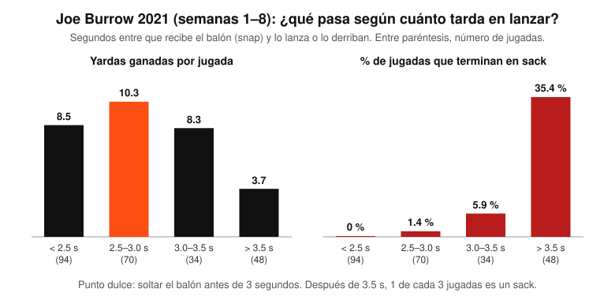

# HardRockData-unam · ¿Cómo sacarle más a Joe Burrow?

Proyecto para el Hackathon NFL Big Data Bowl (UNAM). Es una herramienta web que recomienda qué tipo de jugada ofensiva conviene usar con Joe Burrow, mariscal de campo de los Cincinnati Bengals, según la situación del partido.



## El rol y la pregunta

Nos pusimos en el lugar del **coordinador ofensivo de los Cincinnati Bengals**: la persona que decide qué jugada se ejecuta cuando el equipo tiene el balón.

**Pregunta principal:** según la situación del partido, ¿qué formación, qué tipo de engaño y qué tiempo de lanzamiento le dan a Joe Burrow más yardas, más pases completos y menos sacks?

## Mini glosario (para quien no sigue el futbol americano)

| Término | Qué significa |
|---|---|
| **Mariscal de campo (QB)** | El jugador que recibe el balón al inicio de cada jugada y decide a quién lanzarlo. Joe Burrow es el de los Bengals. |
| **Down** | Intento. El equipo tiene 4 intentos para avanzar 10 yardas; si lo logra, el conteo vuelve a empezar. "3rd down" es el tercer intento, casi siempre el decisivo. |
| **Distancia** | Yardas que faltan para lograr esas 10. Aquí la dividimos en **Corto** (3 o menos), **Medio** (4 a 7) y **Largo** (8 o más). |
| **Pase completo** | El receptor atrapa el balón. |
| **Sack** | Los defensores derriban al mariscal antes de que lance. Es de lo peor que puede pasar: se pierden yardas y el intento. |
| **Formación** | Cómo se acomodan los jugadores antes de la jugada. **SHOTGUN**: el mariscal se para unas 5 yardas atrás. **EMPTY**: nadie se queda junto a él para protegerlo; todos salen a recibir. **SINGLEBACK**: el mariscal recibe el balón pegado al centro, con un corredor detrás. |
| **Play Action** | Un engaño: el mariscal finge entregar el balón a un corredor y luego lanza. |
| **Blitz** | La defensa manda a 5 o más jugadores a perseguir al mariscal, en lugar de los 4 habituales. Presiona más, pero deja menos defensores cuidando a los receptores. |
| **Cobertura hombre / zona** | En **hombre**, cada defensor sigue a un receptor. En **zona**, cada defensor cuida un área del campo. |
| **Presión** | Algún defensor golpeó, apuró o derribó al mariscal durante la jugada. |
| **Time to Throw** | Segundos entre que el mariscal recibe el balón y lo lanza (o lo derriban). |

## Los datos

- **Fuente:** datos del NFL Big Data Bowl 2023 que vienen en la carpeta `data/`. Cubren las semanas 1 a 8 de la temporada 2021 y solo incluyen jugadas de pase.
- **Muestra:** 255 jugadas de Joe Burrow (identificador de jugador `nflId = 52409`) en 8 partidos.
- **Cómo se cruzaron:**
  - `plays.csv` aporta la situación (down, distancia, formación, Play Action, cobertura) y el resultado.
  - `pffScoutingData.csv` aporta la presión y el número de defensores que persiguen al mariscal, que es lo que define el blitz.
  - Los archivos de `tracking/`, con la posición de cada jugador 10 veces por segundo, sirven para medir el Time to Throw.

## Lo que encontramos

**Promedios de Burrow:** completa el 67.7% de sus pases, gana 7.78 yardas por jugada, recibe un sack en el 7.8% de las jugadas y tarda 2.90 segundos en lanzar.

### 1. Lo que más pesa es el reloj: debe soltar el balón antes de 3 segundos

| Tiempo hasta lanzar | Jugadas | Yardas por jugada | % completos | % sacks |
|---|---|---|---|---|
| Menos de 2.5 s | 94 | 8.49 | 72.3% | 0% |
| **2.5 a 3.0 s** | **70** | **10.27** | **69.6%** | **1.4%** |
| 3.0 a 3.5 s | 34 | 8.26 | 71.9% | 5.9% |
| Más de 3.5 s | 48 | 3.65 | 45.2% | 35.4% |

- En sus pases completos tarda 2.67 s en promedio. En sus sacks, 4.62 s.
- Pasando los 3.5 segundos, **1 de cada 3 jugadas termina en sack** y gana menos de la mitad de yardas.
- La presión explica buena parte de esto. Con presión gana 3.19 yardas por jugada y sufre sacks en el 23.8% de las jugadas. Sin presión gana 10.04 yardas y no recibe ningún sack.

### 2. Formación: SHOTGUN es la base más confiable

| Formación | Jugadas | Yardas por jugada | % completos | % sacks |
|---|---|---|---|---|
| SHOTGUN | 150 | 7.91 | 68.1% | 6.7% |
| EMPTY | 69 | 6.10 | 67.7% | 7.2% |
| SINGLEBACK | 27 | 9.00 | 63.6% | 14.8% |

- SINGLEBACK gana más yardas, pero tiene el doble de sacks y pocas jugadas: 25 de sus 27 fueron con Play Action.
- JUMBO, I_FORM y PISTOL tienen menos de 5 jugadas cada una, así que no sacamos conclusiones de ellas.

### 3. Play Action: más yardas, pero más riesgo

| | Jugadas | Yardas por jugada | % completos | % sacks | Tiempo hasta lanzar |
|---|---|---|---|---|---|
| Con Play Action | 52 | 8.92 | 59.1% | 13.5% | 3.45 s |
| Sin Play Action | 203 | 7.49 | 69.8% | 6.4% | 2.75 s |

El engaño gana 1.4 yardas más por jugada, pero hace que Burrow retenga el balón 0.7 segundos más. Por eso completa menos pases y recibe el doble de sacks. Conviene usarlo cuando la protección aguante.

### 4. Burrow castiga el blitz y la cobertura hombre

| Defensa | Jugadas | Yardas por jugada | % completos | % sacks |
|---|---|---|---|---|
| **Blitz** | 71 | **10.32** | **73.8%** | **5.6%** |
| Sin blitz | 184 | 6.80 | 65.2% | 8.7% |
| **Hombre** | 83 | **10.77** | 68.4% | 6.0% |
| Zona | 161 | 6.74 | 68.3% | 8.1% |

Cuando la defensa manda más jugadores a perseguirlo, Burrow lanza rápido (2.77 s en promedio) y encuentra al receptor que quedó libre. Contra defensas en zona, que son las que más le aplicaron, gana casi 4 yardas menos por jugada.

## Cómo usar el Recomendador de Jugada Ofensiva

1. Abre la app y ve a la sección **"Recomendador de Jugada Ofensiva para Joe Burrow"**.
2. Elige el **Down** (Todos, 1st, 2nd o 3rd) y la **Distancia** (Todas, Corto, Medio o Largo).
3. La app filtra las jugadas reales de Burrow en esa situación y muestra tres recomendaciones:
   - **Formación:** la que mejor resultado le dio, con sus yardas por jugada, % de completos, % de sacks y número de jugadas.
   - **Play Action:** si conviene usarlo o no, con la comparación de ambos casos.
   - **Soltar el balón en:** el rango de segundos que mejor le funcionó.
4. Si la muestra es pequeña, aparece un aviso en amarillo. En **"Ver todas las formaciones"** está la tabla completa.

**Cómo decide:** cada opción recibe un puntaje = yardas por jugada + 5 × (% completos) − 10 × (% sacks). El sack pesa el doble que el pase completo porque destruye el avance. Solo compiten las opciones con al menos 5 jugadas, o el 10% de la situación si es más.

**Ejemplos:**
- **1st down y distancia larga:** SHOTGUN sin Play Action. En 41 jugadas promedió 10.0 yardas, 70% de completos y ningún sack.
- **3rd down y distancia larga:** SHOTGUN. En 19 jugadas completó el 87.5% de sus pases.

Debajo del recomendador están las tarjetas con los promedios generales y tres gráficas:
- Rendimiento por formación, con y sin Play Action.
- Rendimiento contra blitz y sin blitz, y contra cobertura hombre y zona.
- El "punto dulce" del Time to Throw.

## Limitaciones

- **Muestra pequeña.** Son 8 partidos. Algunas combinaciones de down y distancia tienen menos de 10 jugadas; ahí la recomendación es un indicio, no una regla, y la app lo avisa. Con "Todos / Todas", SINGLEBACK le gana a SHOTGUN por muy poco (10.70 contra 10.65 puntos) y con solo 27 jugadas.
- **Correlación, no causa.** Los datos muestran qué funcionó, no garantizan que vuelva a funcionar. Por ejemplo, las defensas pueden elegir el blitz justo en las situaciones donde Burrow ya tenía ventaja.
- **Scrambles sin tiempo.** Las 9 jugadas en que Burrow salió corriendo no tienen Time to Throw.
- **Sin EPA.** No usamos EPA, una métrica avanzada de valor por jugada, porque no viene en estos datos.

## Stack

| Capa | Tecnología |
|---|---|
| Datos | Python 3.12, pandas 2.2.3, numpy 2.1.3 |
| Backend (API) | FastAPI 0.115.14, Uvicorn 0.34.3 |
| Dashboard | React 18.3.1, Vite 5.4.21, TypeScript 5.7.3, Tailwind CSS 3.4.19, Recharts 3.10.1 |

**Estructura:**
- `backend/procesar_burrow.py`: cruza los datos y genera `backend/datos/burrow_jugadas.csv`.
- `backend/analisis.py`: métricas y lógica del recomendador.
- `backend/main.py`: la API. Expone `GET /health`, `GET /api/resumen` y `GET /api/recomendacion?down=&distancia=`.
- `dashboard/src/`: la interfaz.

## Cómo ejecutarlo

Desde la raíz del proyecto, con el entorno ya preparado por `.hackathon/setup`.

**1. (Opcional) Regenerar los datos procesados.** Si el archivo no existe, la API lo calcula al arrancar.

```powershell
.\.venv\Scripts\python.exe -m backend.procesar_burrow      # Windows
.venv/bin/python -m backend.procesar_burrow                # macOS / Linux
```

**2. Levantar la API** en el puerto 8000.

```powershell
.\.venv\Scripts\python.exe -m uvicorn backend.main:app --reload --port 8000   # Windows
.venv/bin/uvicorn backend.main:app --reload --port 8000                       # macOS / Linux
```

**3. Levantar el dashboard** en otra terminal y abrir http://localhost:5173.

```powershell
cd dashboard
npm run dev
```

En Windows, si PowerShell bloquea `npm`, usa el Node incluido en la plantilla:

```powershell
$env:Path = "$((Resolve-Path ..\.hackathon\.tools\node).Path);$env:Path"
npm.cmd run dev
```

Para generar la versión de producción: `npm run build` dentro de `dashboard/`. El resultado queda en `dashboard/dist`.
